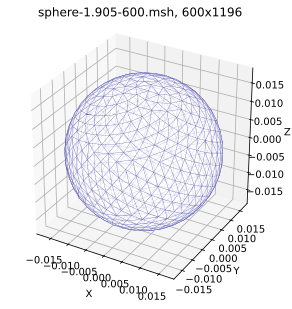
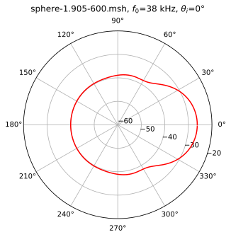
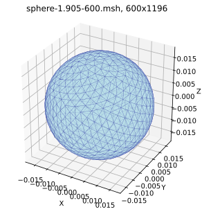
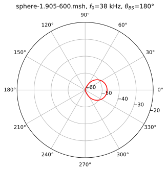
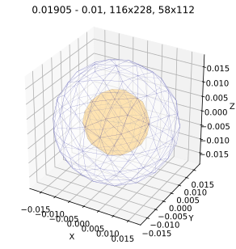
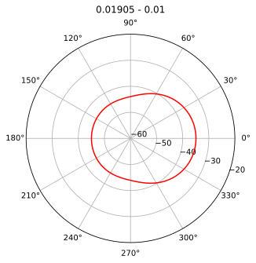
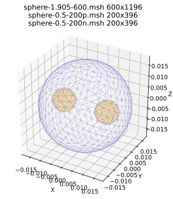
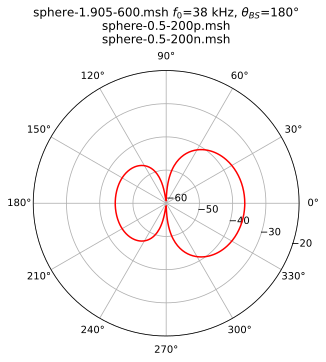

## Jupyter notebooks with python mm-bem codes using bempp library

The notebooks show the folowing cases of acoustic scattering of plane wave in water:

1. soft scattering - [soft.ipynb](soft.ipynb) (without bempp library), [soft\_bempp.ipynb](soft_bempp.ipynb)
2. fluid scattering - [fluid\_bempp.ipynb](fluid_bempp.ipynb)
3. fluid with one inclusion scattering - [shell\_bempp.ipynb](shell_bempp.ipynb)
4. fluid with two inclusions scattering - [scat3\_bempp.ipynb](scat3_bempp.ipynb)

Each example contains:

- BEM python code
- mesh 3D preview
- scattering function polar plot in dB
- two-column scattering function (degree, scattering pressure)

Moreover it contains calculations of the scattering function from yellowfin tuna swimbladder in dorsal aspect using several technologies:
- scipy lu_solver - [yft\_scipy.ipynb](yft_scipy.ipynb)
- bempp gmres solver - [yft\_bempp.ipynb](yft_bempp.ipynb)
- pytorch solver - [yft\_pytorch.ipynb](yft_pytorch.ipynb)
- taichi + scipy lu_solver - [yft\_taichi.ipynb](yft_taichi.ipynb)
The swimbladder mesh (fname = "YFT_swimbladder_origin.msh" ) contains 7502 vertices nad 15000 triangles. The calculation times on MacBookPro M1 with Sequoia 15.7.7 are as follows:

|YFT_swimbladder_origin.msh| time |
|:---|:---:|
|1. scipy|2m 41.5s|
|2. bempp|45.5s|
|3. pytorch|28.9s|
|4. taichi|7.2s|

Examples:

1. Scattering from soft target

2. Scattering from fluid target

2. Scattering from fluid with inclusion

2. Scattering from fluid with two inclusions

Note:
All mesh datafiles are in [msh](../msh/) directory (datapath = "../msh/" variable)

MM 31.10.2026
